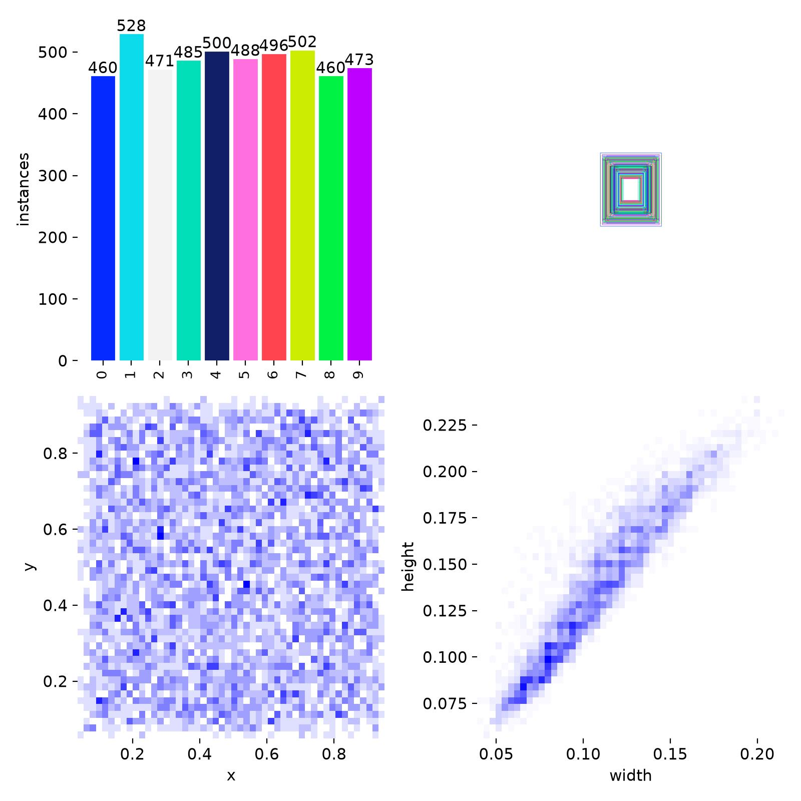
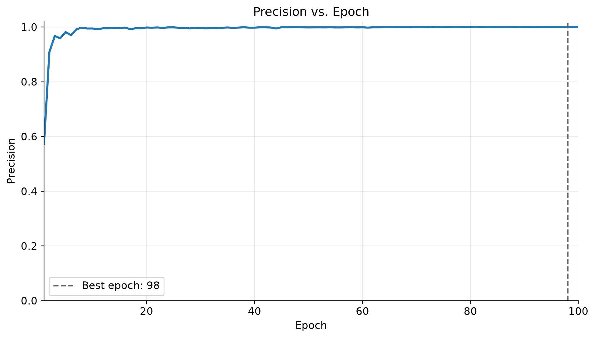
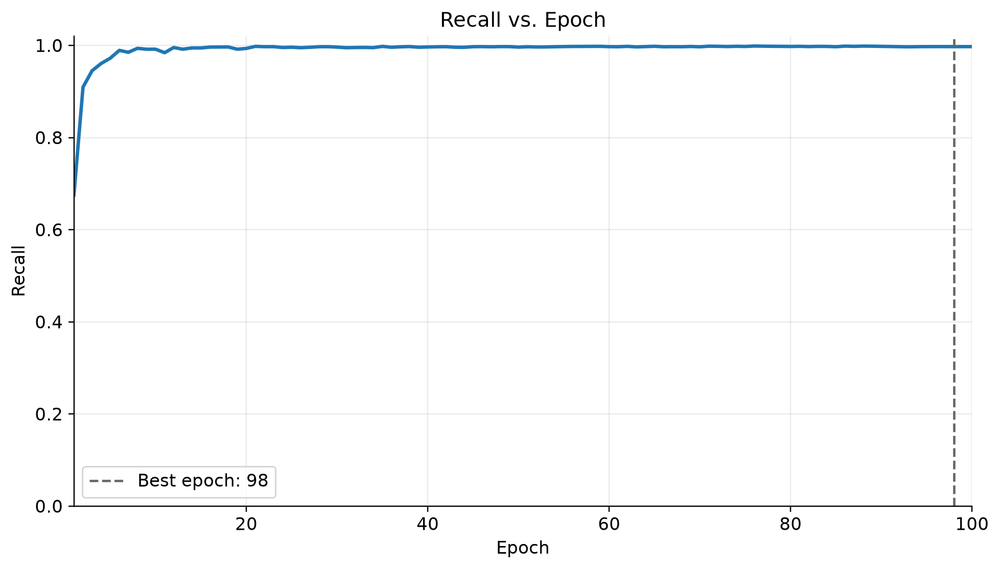
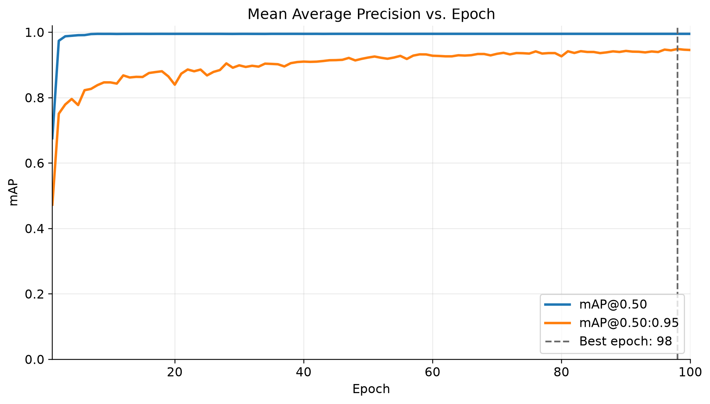
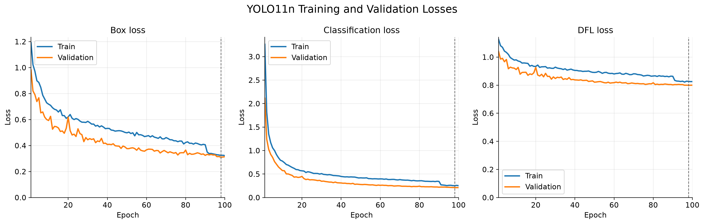
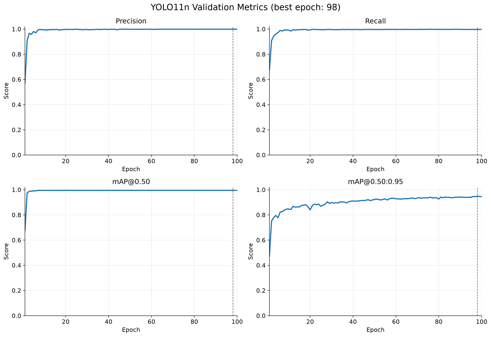
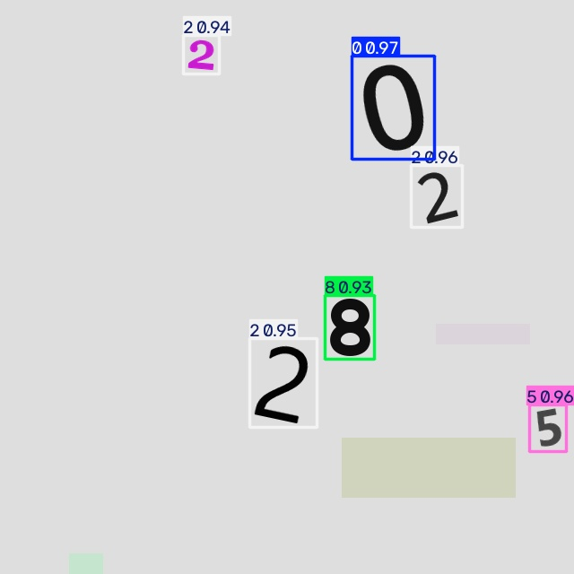
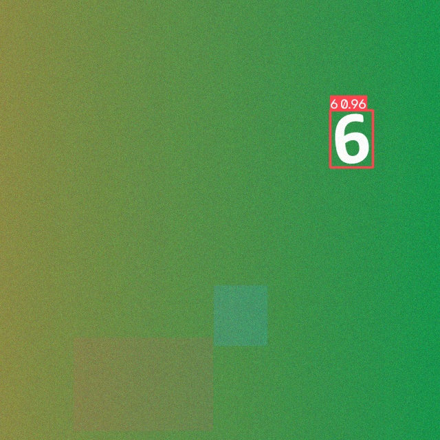

# 03 YOLO11n 多目标数字检测

本项目使用 YOLO11n 检测一张图片中的多个阿拉伯数字 `0～9`。任务属于目标检测：模型不仅要判断数字类别，还要输出每个数字的位置边界框。

## 一、总体思路

拿到题目后，我将任务拆分为“数据构建—标签检查—流程验证—正式训练—独立测试—结果解释”六个阶段：

1. **选择模型**：使用轻量级 YOLO11n，在 RTX 4060 Laptop GPU 上兼顾训练速度、检测性能和现场演示效率；
2. **构建数据**：用固定随机种子生成 2000 张 `640×640` 合成图片，每张包含 1～6 个数字，并同步生成 YOLO 边界框标签；
3. **提高数据多样性**：随机改变字体、字号、位置、旋转、前景颜色、彩色或灰度背景、亮度、对比度、模糊、噪声和少量遮挡，减少模型对单一字体和背景的依赖；
4. **检查标签**：将 YOLO 标签重新绘制到随机抽取的图片上，人工检查类别和边界框；
5. **分阶段训练**：先运行 3 个 epoch 的冒烟训练，确认数据格式、CUDA 和训练流程无误，再完成 100 个 epoch 的正式训练；
6. **客观评估**：验证集用于选择最佳模型，200 张独立测试图片只用于最终评估，并保存 Precision、Recall、mAP、Loss、PR 曲线、F1 曲线、混淆矩阵和预测图片。

整体流程：

```text
生成多样化数据
      ↓
生成 YOLO 标签
      ↓
随机回绘标签检查
      ↓
3 epoch 冒烟训练
      ↓
100 epoch 正式训练
      ↓
按验证集 mAP50-95 选择 best.pt
      ↓
独立测试集评估与推理展示
```

## 二、数据集

| 项目 | 数值 |
|---|---:|
| 总图片数 | 2000 |
| 训练集 | 1400 |
| 验证集 | 400 |
| 测试集 | 200 |
| 图片尺寸 | 640 × 640 |
| 每张目标数 | 1～6 |
| 类别数 | 10（数字 0～9） |
| 随机种子 | 42 |

完整数据约 500 MB，因此仓库不重复保存 2000 张生成图片，而是保留生成脚本、随机种子、数据摘要和少量样例。运行脚本即可复现相同的数据组织方式。

类别分布：



## 三、训练配置

| 项目 | 配置 |
|---|---|
| 模型 | YOLO11n |
| 预训练权重 | `models/yolo11n.pt` |
| Epochs | 100 |
| Batch size | 8 |
| Image size | 640 |
| GPU | NVIDIA GeForce RTX 4060 Laptop GPU |
| Device | CUDA:0 |
| Seed | 42 |

完整配置记录在 [records/experiment.yaml](records/experiment.yaml)，每个 epoch 的原始数据记录在 [records/results.csv](records/results.csv)。

## 四、正式结果

验证集按 mAP50-95 选择的最佳轮次是第 98 个 epoch：

| 指标 | 验证集最佳结果 |
|---|---:|
| Precision | 0.99938 |
| Recall | 0.99732 |
| mAP50 | 0.99500 |
| mAP50-95 | 0.94875 |

最佳权重在 200 张、697 个数字实例的独立测试集上取得：

| 指标 | 独立测试集结果 |
|---|---:|
| Precision | 0.999 |
| Recall | 0.994 |
| mAP50 | 0.993 |
| mAP50-95 | 0.944 |

测试结果原始摘要见 [records/test_metrics.json](records/test_metrics.json)。这些结果说明模型在当前合成数据分布上表现优秀，但不能直接代表所有真实摄像头场景。

## 五、关键指标图片

所有关键图片集中保存在 [`artifacts/metrics`](artifacts/metrics)。

### Precision



Precision 表示模型输出的检测结果中有多少是真的。越高表示误检越少。

### Recall



Recall 表示所有真实目标中有多少被模型找到。越高表示漏检越少。

### mAP



mAP50关注模型能否找到并识别目标；mAP50-95使用更严格的多个 IoU 阈值，更能反映边界框定位精度。

### Loss



Box loss反映框的位置误差，Classification loss反映类别误差，DFL loss用于学习更精细的边界分布。Loss主要观察是否下降以及训练集和验证集是否明显分离。

### 指标总览



更详细的定义、高低含义、过拟合判断和面试回答方式见：

**[YOLO 指标曲线面试讲稿](docs/interview_metrics_guide.md)**

## 六、预测示例

仓库提供 8 张独立测试集预测图片，保存在 [`artifacts/predictions`](artifacts/predictions)。





## 七、项目结构

```text
03_yolo11n_digits/
├── README.md
├── requirements.txt
├── data.yaml
├── scripts/
│   ├── generate_dataset.py       # 生成 2000 张可复现数据
│   ├── visualize_labels.py       # 随机回绘标签检查
│   ├── train_yolo.py             # 正式训练
│   ├── evaluate_model.py         # 独立测试集评估
│   ├── predict_samples.py        # 示例图片推理
│   └── plot_metrics.py           # 根据 CSV 生成指标曲线
├── models/
│   ├── yolo11n.pt                # 官方预训练起点
│   └── best.pt                   # 本次正式训练最佳权重
├── records/
│   ├── experiment.yaml           # 实验参数
│   ├── dataset_summary.json      # 数据集统计
│   ├── results.csv               # 100 epoch 原始训练日志
│   └── test_metrics.json         # 独立测试集结果
├── samples/
│   ├── images/                   # 少量测试样例
│   └── labels/                   # 对应 YOLO 标签
├── artifacts/
│   ├── metrics/                  # Precision、Recall、mAP、Loss 等曲线
│   ├── predictions/              # 带预测框的结果图
│   └── dataset_audit/            # 数据与类别分布检查图
└── docs/
    └── interview_metrics_guide.md
```

训练产生的完整 `dataset/` 和 `runs/` 体积较大，已通过 `.gitignore` 排除，可以使用项目脚本重新生成。

## 八、环境安装

推荐使用 Python 3.11。先根据电脑显卡和 CUDA 环境安装对应的 PyTorch，再执行：

```powershell
python -m pip install -r requirements.txt
```

检查环境：

```powershell
python -c "import torch, ultralytics; print(torch.__version__); print('CUDA:', torch.cuda.is_available()); print('Ultralytics:', ultralytics.__version__)"
```

## 九、复现流程

### 1. 生成完整数据集

```powershell
python scripts\generate_dataset.py --output dataset --count 2000 --seed 42
```

### 2. 随机抽取 50 张图片检查标签

```powershell
python scripts\visualize_labels.py --dataset dataset --count 50 --seed 42
```

### 3. 冒烟训练

```powershell
python scripts\train_yolo.py --epochs 3 --name smoke_test
```

### 4. 正式训练

```powershell
python scripts\train_yolo.py
```

### 5. 独立测试集评估

```powershell
python scripts\evaluate_model.py
```

### 6. 对仓库示例图片推理

```powershell
python scripts\predict_samples.py
```

### 7. 重新生成指标曲线

```powershell
python scripts\plot_metrics.py
```

## 十、结论与局限

- YOLO11n 已完成从数据生成、标签检查、冒烟训练、正式训练到独立测试的完整流程；
- Precision、Recall、mAP、Loss、PR、F1、混淆矩阵和推理图片均已保存；
- 当前数据主要由程序合成，训练、验证和测试来自相同生成规则，因此高指标不能等同于真实场景性能；
- 后续应补充真实拍摄数字，覆盖反光、遮挡、低照度、倾斜、小目标和复杂背景；
- 数字 `9` 和 `3` 的严格 mAP 相对较低，应优先进行失败案例分析和针对性数据补充。
