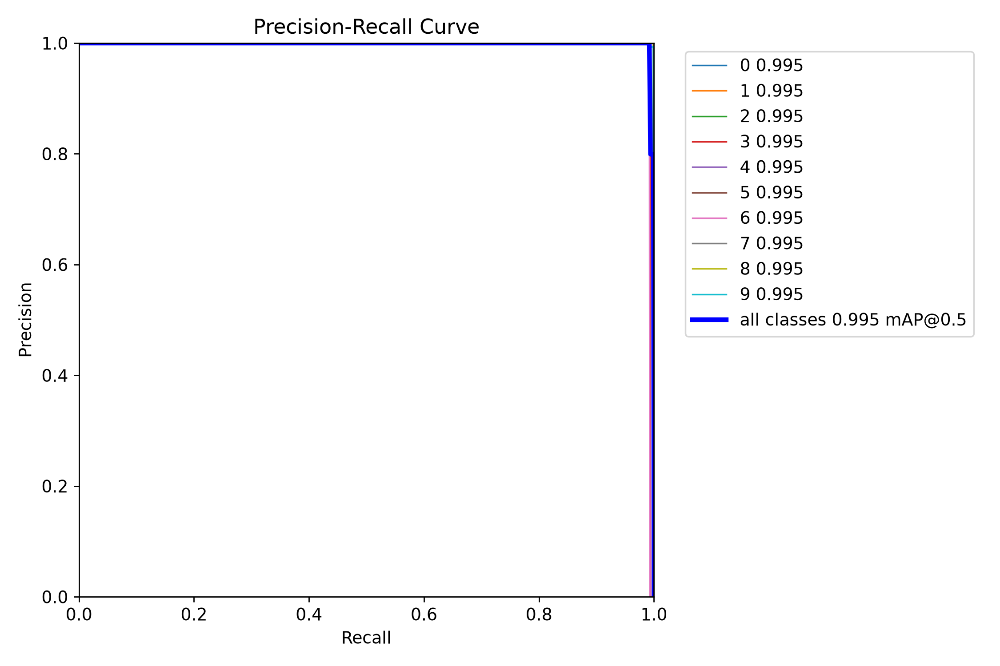
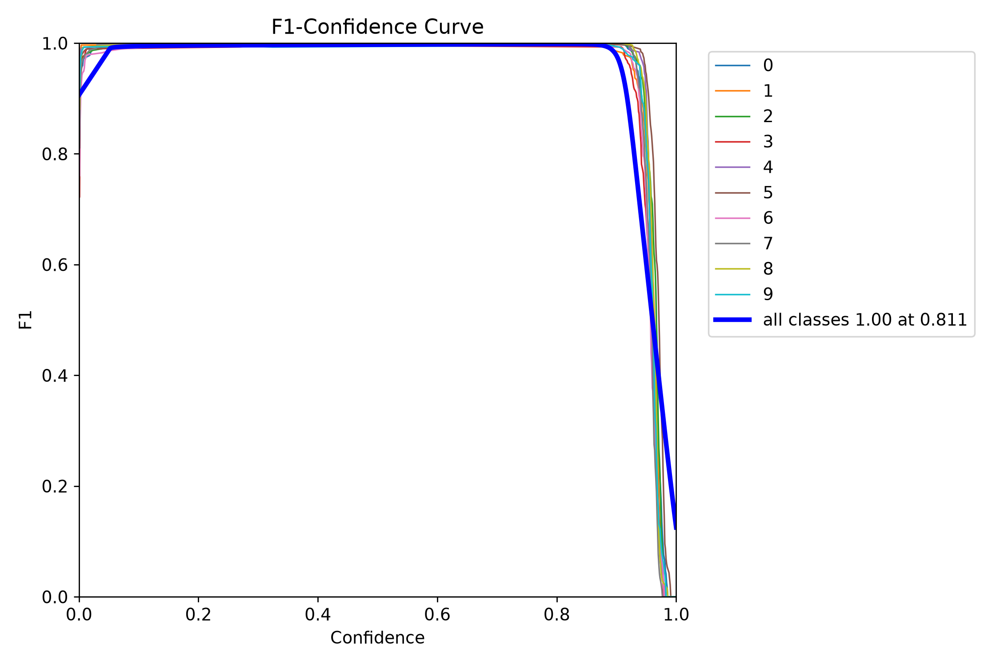
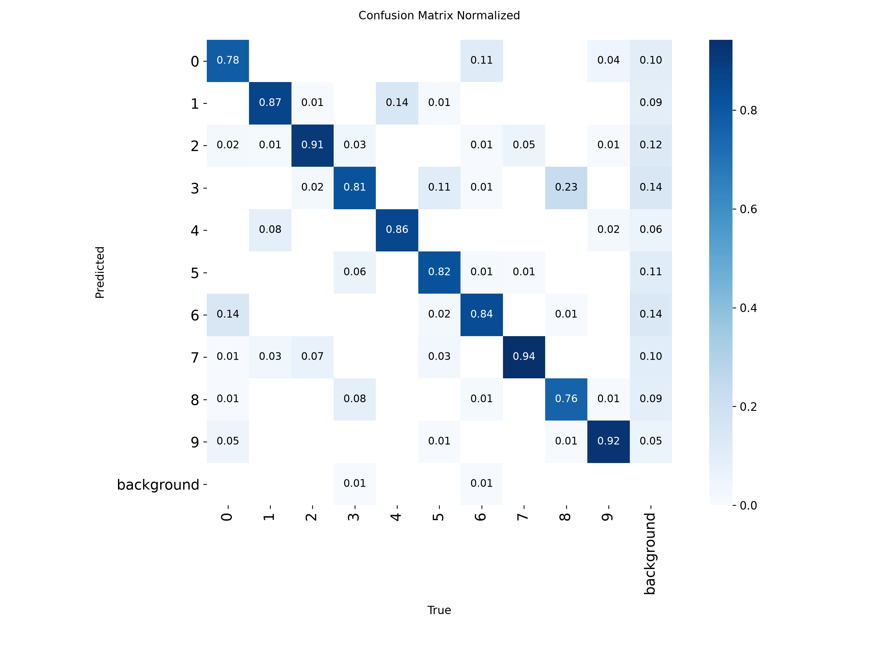

# YOLO 指标曲线面试讲稿

这份讲稿对应 `artifacts/metrics` 中由 100 个 epoch 正式训练记录生成的图片。面试时不需要逐字背诵，但应按照“定义—高低含义—观察曲线—结合本实验解释”的顺序回答。

## 1. 先说明四种预测结果

在解释 Precision 和 Recall 前，先明确检测结果的四种情况：

- **TP（True Positive，真正例）**：模型检测到了真实存在的数字，而且类别和位置满足判定条件；
- **FP（False Positive，假正例）**：模型给出了检测框，但该目标不存在、类别错误或位置不合格，也就是误检；
- **FN（False Negative，假负例）**：图片中确实有数字，但模型没有检测出来，也就是漏检；
- **TN（True Negative，真负例）**：正确判断某处没有目标。目标检测通常不把无数背景位置逐个统计为 TN，因此主要关注 TP、FP 和 FN。

## 2. Precision：预测得准不准


公式：

```text
Precision = TP / (TP + FP)
```

推荐表述：

> Precision 表示模型给出的所有检测结果中，有多少是真正正确的目标。Precision 高，说明误检少；Precision 低，说明模型容易把背景或其他数字错误地当成目标。它主要回答“模型报出来的结果有多可信”。

- **高 Precision**：FP 少，检测结果更可信；
- **低 Precision**：FP 多，误检严重；
- Precision 高不代表没有漏检，还必须结合 Recall；
- 本实验验证集最佳 Precision 为 `0.99938`，独立测试集约为 `0.999`，说明在当前合成数据中误检极少。

## 3. Recall：真实目标找全没有


公式：

```text
Recall = TP / (TP + FN)
```

推荐表述：

> Recall 表示所有真实存在的目标中，有多少被模型成功找出来。Recall 高，说明漏检少；Recall 低，说明图片里虽然有数字，但模型经常没有发现。它主要回答“真实目标找全了吗”。

- **高 Recall**：FN 少，漏检少；
- **低 Recall**：FN 多，真实目标容易被遗漏；
- Recall 高不代表结果都准确，模型也可能用大量低质量框换取较少漏检，因此要结合 Precision；
- 本实验验证集最佳 Recall 为 `0.99732`，独立测试集约为 `0.994`。

## 4. Precision 和 Recall 的关系

提高置信度阈值时，模型只保留更有把握的框，通常 Precision 上升、Recall 下降；降低置信度阈值时，模型输出更多框，通常 Recall 上升、Precision 下降。因此二者存在取舍。

适合面试时举例：

> 如果任务更怕误报，例如错误识别会触发危险操作，我会更重视 Precision；如果任务更怕漏掉目标，例如缺陷检测或安全预警，我会更重视 Recall。实际部署时应根据业务代价选择置信度阈值。

## 5. IoU：预测框和真实框重叠得多不多

IoU（Intersection over Union）等于预测框与真实框的交集面积除以并集面积：

```text
IoU = 交集面积 / 并集面积
```

- IoU 越接近 1，两个框越重合；
- IoU 越低，预测框的位置或大小越不准确；
- 计算 AP 前，需要设定 IoU 阈值判断预测框是否合格。

## 6. AP 与 mAP：综合检测能力


- **AP（Average Precision）**：某一个类别的 Precision-Recall 曲线下面积；
- **mAP（mean Average Precision）**：全部类别 AP 的平均值；
- 本项目有数字 `0～9` 十个类别，因此 mAP 是十个数字类别 AP 的平均值。

### mAP@0.50

预测框与真实框的 IoU 达到 0.50 即可视为位置合格。这个标准相对宽松，更关注模型能否找到并正确识别目标。

- 数值高：模型大体能够找到并识别目标；
- 数值低：模型在分类、检出或定位方面存在明显问题。

### mAP@0.50:0.95

分别在 `0.50、0.55……0.95` 十个 IoU 阈值下计算 AP，再取平均。由于包含很严格的 `0.95`，它比 mAP50 更能反映边界框定位是否精确。

- 数值高：分类正确，并且预测框位置、大小更贴近真实框；
- 数值明显低于 mAP50：模型大多能找到目标，但边界框还不够精确；
- 本实验验证集最佳 mAP50 为 `0.99500`，mAP50-95 为 `0.94875`；独立测试集分别为 `0.993` 和 `0.944`。

推荐解释：

> 本次 mAP50 很快接近上限，说明模型较早学会了找到并区分数字；mAP50-95 随训练继续提升，说明后续训练主要在改进边界框定位精度。

## 7. Loss：模型训练时正在优化的误差


Loss 越低通常越好，但它不是百分比，也不能直接说“Loss 0.3 等于准确率 70%”。Loss 主要用于观察模型是否收敛、训练和验证表现是否分离。

### Box loss

衡量预测框位置、宽高与真实框之间的误差。

- 高：预测框定位偏差较大；
- 低：预测框位置和尺寸更准确。

### Classification loss

衡量模型对 `0～9` 类别判断的错误程度。

- 高：模型较难区分数字类别；
- 低：类别判断更稳定。

### DFL loss

DFL 是 Distribution Focal Loss，YOLO 使用它学习更精细的边界位置分布。

- 高：边界位置仍不稳定；
- 低：边界位置学习得更精细；
- DFL 的绝对值不能与 Box loss 或 Classification loss直接横向比较，重点观察它自身是否下降。

### 如何判断过拟合

- 训练 Loss 和验证 Loss 同步下降：模型正在正常学习；
- 训练 Loss 继续下降，但验证 Loss 持续上升：可能开始过拟合；
- 训练和验证指标都长期不再改善：模型可能已经收敛；
- 本次训练中，训练与验证 Loss 整体同步下降，验证 Loss 没有持续反弹，因此没有明显过拟合迹象；
- 验证 Loss 偶尔低于训练 Loss 不一定异常，因为训练阶段使用了 Mosaic、颜色和尺度等数据增强，训练样本可能比验证样本更难。

## 8. PR 曲线



PR 曲线横轴为 Recall，纵轴为 Precision，表示改变置信度阈值时二者的取舍：

- 曲线越靠近右上角越好；
- 曲线下面积就是 AP；
- 如果提高 Recall 时 Precision 快速下降，说明模型为了找全目标产生了较多误检；
- PR 曲线与“Precision、Recall 随 epoch 变化图”不同：前者观察最终模型在不同置信度阈值下的取舍，后者观察训练过程是否逐步收敛。

## 9. F1 曲线



F1 是 Precision 和 Recall 的调和平均：

```text
F1 = 2 × Precision × Recall / (Precision + Recall)
```

- F1 高：Precision 和 Recall 都比较高且较平衡；
- 只要其中一项很低，F1 就会明显下降；
- F1 曲线可以帮助选择兼顾误检与漏检的置信度阈值；
- 但部署阈值最终仍应根据业务对误检和漏检的不同代价决定。

## 10. 混淆矩阵



- 纵横轴分别表示真实类别和预测类别；
- 主对角线越亮、越接近 1，说明该类别越容易被正确识别；
- 非对角线位置出现数值，说明两个类别容易混淆；
- 本实验中数字 `9` 和 `3` 的 mAP50-95 相对较低，后续应优先测试它们在低对比度、旋转和复杂背景中的表现。

## 11. 如何总结本次训练结果

可以使用下面这段话作为面试总结：

> 我使用 YOLO11n 完成了 0 到 9 多目标数字检测。首先用固定随机种子生成 2000 张合成图片，按照 1400、400、200 划分训练集、验证集和独立测试集，并通过标签回绘检查数据。随后先进行 3 个 epoch 的冒烟训练，确认数据格式、CUDA 和训练流程无误，再完成 100 个 epoch 的正式训练。模型在第 98 个 epoch 获得最高验证集 mAP50-95。最后使用没有参与训练和模型选择的 200 张测试图片进行独立评估，Precision 为 0.999、Recall 为 0.994、mAP50 为 0.993、mAP50-95 为 0.944。结果说明模型在当前合成数据上表现良好，但仍不能直接代表真实场景，下一步应加入真实拍摄、反光、遮挡、低照度和小目标数据验证泛化能力。

## 12. 面试官可能追问的问题

### 为什么选 YOLO11n？

YOLO11n 是 YOLO11 中参数量和计算量较小的版本，训练速度快，对 RTX 4060 Laptop GPU 友好，适合作为面试任务的可复现基线。它能够在有限时间内完成多轮实验，同时保留实时检测潜力。

### 为什么不能只报告训练集指标？

训练集是模型直接学习过的数据，只看训练结果容易高估性能。验证集用于训练过程中的模型选择和调参，独立测试集则用于最后一次客观评估。因此最终结论应优先参考测试集。

### 为什么指标这么高？

当前数据由程序合成，数字边界和标签准确，而且训练集、验证集、测试集来自相同的生成规则，所以任务相对可控。高指标证明流程和模型在当前数据分布上有效，但不能宣称对所有真实场景都有同样性能。

### mAP50 已经很高，为什么还要看 mAP50-95？

mAP50 对边界框位置要求较宽松，可能出现“目标找到了，但框不够贴合”的情况。mAP50-95加入更严格的 IoU 阈值，能够更好地区分粗略检测与精确定位。

